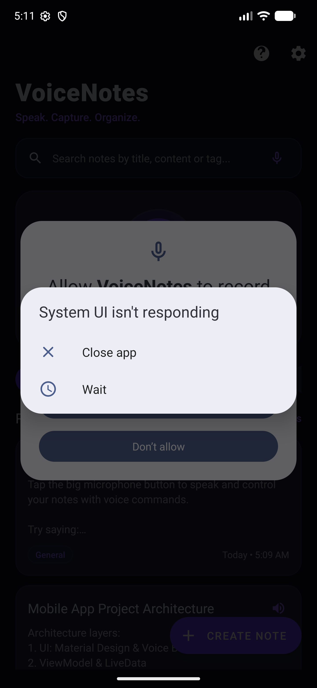
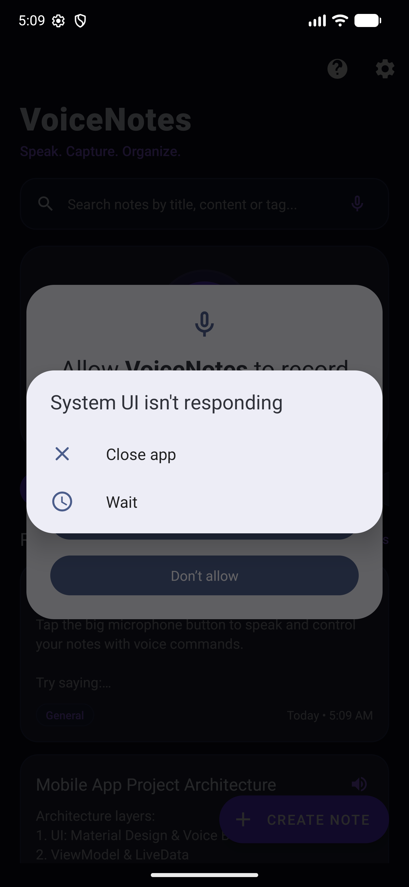
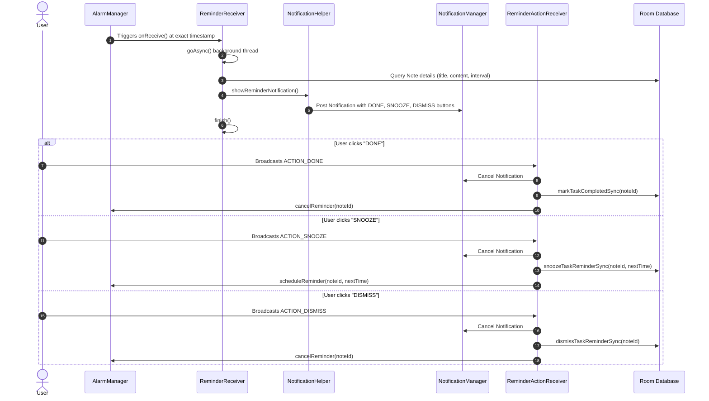

# 🎙️ VoiceNotes — Voice Controlled Notes & Smart Task Manager

> **Speak. Capture. Organize. Conquer.**  
> A production-ready, offline-first Android application developed in **Java** featuring natural voice command processing, real-time speech-to-text dictation, intelligent to-do tracking, exact-time reminders with interactive notifications, and a sleek futuristic Material Design interface.

---

<p align="center">
  
  &nbsp;&nbsp;&nbsp;&nbsp;
  
</p>

<p align="center">
  
  
  
  
  
  
  
</p>

---

## 📑 Table of Contents
1. [Key Highlights & Features](#-key-highlights--features)
2. [Application Architecture](#-application-architecture)
3. [Database Schema & Migration](#-database-schema--migration)
4. [Intelligent Voice Command System](#-intelligent-voice-command-system)
5. [Smart Reminders & Interactive Notifications](#-smart-reminders--interactive-notifications)
6. [Technology Stack & Libraries](#-technology-stack--libraries)
7. [Project Package Structure](#-project-package-structure)
8. [Setup & Installation](#-setup--installation)
9. [Permissions & Privacy](#-permissions--privacy)
10. [College Viva & Project Defense Q&A](#-college-viva--project-defense-qa)

---

## 🌟 Key Highlights & Features

### 🎙️ 1. Multi-Modal Voice Recognition & Dictation
- **Floating Hero Microphone**: One-tap trigger from any screen to initiate voice listening.
- **Dynamic Waveform Visualizer**: Real-time 6-bar audio visualizer reacting dynamically to audio decibel (RMS dB) levels.
- **In-Editor Dictation**: Seamlessly append spoken text directly into note titles or content with live partial transcription.
- **Deterministic Intent Parsing**: Differentiates automatically between high-level commands (e.g. *"Create a note"*, *"Mark task as done"*) and freeform speech dictation.

### 📝 2. Dual Note & Smart To-Do System
- **Unified Card Architecture**: Seamlessly handles both standard notes and actionable checklist items in a single stream.
- **Interactive Checkboxes**: One-tap task completion with strikethrough typography, dynamic status badging, and completion timestamps.
- **Multi-Tier View Filtering**: Filter items effortlessly via Material toggle buttons:
  - **All Items**
  - **Regular Notes**
  - **Active To-Dos**
  - **Completed History**
- **Category Taxonomy**: Pre-configured categories (`General`, `Work`, `Study`, `Ideas`, `Personal`, `To-Do`) with horizontal filtering chips.
- **Pin to Top**: Keep high-priority notes and critical tasks fixed at the top of the feed.

### ⏰ 3. Exact Reminders & Actionable Notifications
- **Battery-Optimized Exact Alarms**: Utilizes Android's `AlarmManager.setAlarmClock()` to guarantee exact-to-the-minute execution, even in Doze mode.
- **Interactive Notification Action Buttons**: Manage alerts without opening the app:
  - **DONE**: Immediately marks the task completed in the database and cancels the alarm.
  - **SNOOZE**: Delays reminder by 10 minutes (or user-defined repeat interval).
  - **DISMISS**: Clears the notification while preserving the task status.
- **Configurable Repeat Intervals**: Schedule reminders that recur: *Once*, *Every 5m*, *Every 10m*, *Every 15m*, *Every 30m*, or *Every 1 hour*.
- **Customizable Sound Profiles**: Dedicated Android Notification Channels supporting *Default*, *Classic*, *Soft*, *Attention*, *Urgent*, and *Silent* alerts.
- **Reboot Resilience**: A dedicated `BootReceiver` automatically queries Room and reschedules all pending alarms upon device reboot.

### 🔊 4. Text-to-Speech (TTS) Engine
- **Quick-Read Note Cards**: Instant speaker button on every note card to read the note aloud.
- **Voice-Triggered Playback**: Spoken commands to read the latest note or summarize all saved items.
- **Customizable Voice Controls**: Fine-tune speech rate and pitch via sliders in Settings with real-time audio sample testing.

### 🔍 5. Instant Multi-Field Search
- Real-time search indexing matching **Title**, **Content**, and **Category**.
- Voice-activated search queries (e.g., *"Search notes for Machine Learning"*).
- Category refinement chips within the search screen.

### 🎨 6. Futuristic Material Design
- Modern dark cyberpunk & light palettes (`#0B1020` obsidian dark surface, `#6C3BFF` deep neon purple, `#00E5FF` electric cyan accents).
- Material Design 3 elevation, rounded corner radii (16dp cards, 24dp bottom sheets), and smooth layout transitions.
- Automatic or manual Light / Dark / System theme switching.

### 📤 7. Local Export & Safety
- **Direct Text Export**: Share single notes or export all notes as cleanly formatted `.txt` files to WhatsApp, Google Drive, Gmail, or local storage.
- **Undo Accidental Deletions**: Instant Snackbar recovery with complete reminder restoration.

---

## 🏗️ Application Architecture

VoiceNotes is engineered according to the standard Android **MVVM (Model-View-ViewModel)** architectural pattern, enforcing strict separation of concerns, reactive data binding via `LiveData`, and decoupled repository mediation.

```text
               ┌───────────────────────────────────────────────────────────┐
               │                     Presentation Layer                    │
               │   Activities: MainActivity, NoteEditActivity,             │
               │               SearchActivity, SettingsActivity            │
               │   Dialogs:    VoiceBottomSheetDialog, VoiceHelpDialog,    │
               │               ReminderPickerDialog                        │
               │   Adapters:   NoteAdapter, CategoryAdapter                │
               └───────────────▲───────────────────────────▲───────────────┘
                               │ Observes LiveData         │ Triggers Actions
                               ▼                           │
               ┌───────────────────────────────────────────────────────────┐
               │                      ViewModel Layer                      │
               │                     [ NoteViewModel ]                     │
               │  - Dual-tier Transformation (SwitchMap & Map)             │
               │  - View Filtering (All / Notes / Todos / Completed)       │
               │  - Category Filtering                                     │
               └───────────────────────────────▲───────────────────────────┘
                                               │ Mediates queries & writes
                                               ▼
               ┌───────────────────────────────────────────────────────────┐
               │                     Repository Layer                      │
               │                    [ NoteRepository ]                     │
               │  - Manages background thread pools via ExecutorService    │
               │  - Abstracted API for Database Operations                 │
               └───────▲───────────────────────▲───────────────────▲───────┘
                       │                       │                   │
         ┌─────────────▼─────────┐   ┌─────────▼─────────┐  ┌──────▼──────┐
         │     Local Database    │   │  Voice Processing │  │  Reminders  │
         │  [ Room: AppDatabase  │   │  - SpeechRecognizer│ │ - AlarmMgr  │
         │    NoteDao / Entity ] │   │  - VoiceCommand   │  │ - Receivers │
         │   (SQLite ORM, v2)    │   │  - TTSManager     │  │ - NotifHelp │
         └───────────────────────┘   └───────────────────┘  └─────────────┘
```

### Layer Responsibilities
1. **Presentation (UI) Layer**: Android Activities, XML layouts, and Bottom Sheet Dialogs. Purely responsible for rendering UI states and delegating user input to the ViewModel or Voice Managers.
2. **ViewModel Layer (`NoteViewModel`)**: Holds lifecycle-conscious UI state. Uses `Transformations.switchMap` combined with `Transformations.map` to dynamically combine view type filters (Notes vs. To-Dos vs. Completed) and category filters into a single reactive `LiveData<List<Note>>`.
3. **Repository Layer (`NoteRepository`)**: Acts as the single source of truth for application data, coordinating between the Room database and asynchronous thread pools (`ExecutorService`).
4. **Voice Processing Engine (`VoiceRecognitionManager` & `VoiceCommandProcessor`)**: Encapsulates Android's `SpeechRecognizer`, calculates live audio RMS decibels for wave animation, and parses spoken utterances with regex-based NLP intent classification.
5. **Reminder Engine (`ReminderManager`, `ReminderReceiver`, `ReminderActionReceiver`, `BootReceiver`)**: Orchestrates exact alarm scheduling via `AlarmManager`, delivers interactive notifications, handles background action intents (`goAsync()`), and reschedules alarms on system boot.

---

## 🗄️ Database Schema & Migration

VoiceNotes utilizes the **AndroidX Room Persistence Library** (SQLite ORM) with compile-time SQL verification, reactive `LiveData` queries, and automated database migrations.

### `notes` Table Schema (Database Version 2)

| Column | Data Type | Constraint / Default | Description |
| :--- | :--- | :--- | :--- |
| `id` | `INTEGER` | `PRIMARY KEY AUTOINCREMENT` | Unique identifier for each item |
| `title` | `TEXT` | Indexed | Title of the note or task |
| `content` | `TEXT` | `NULLABLE` | Body text or task description |
| `category` | `TEXT` | Indexed, Default: `'General'` | Category tag (`General`, `Work`, `Study`, `Ideas`, `Personal`, `To-Do`) |
| `createdAt` | `INTEGER` | Epoch Millis (`NOT NULL`) | Timestamp when the item was first created |
| `updatedAt` | `INTEGER` | Indexed, Epoch Millis | Timestamp of the most recent modification |
| `reminderTime` | `INTEGER` | Epoch Millis, Default: `0` | Scheduled reminder time (0 if no reminder) |
| `isReminderEnabled` | `INTEGER (BOOLEAN)` | Default: `0` (`false`) | Flag indicating if reminder alarm is currently active |
| `isPinned` | `INTEGER (BOOLEAN)` | Default: `0` (`false`) | Flag to pin item to the top of the list |
| `colorHex` | `TEXT` | Default: `'#6C3BFF'` | Accent color hex code |
| `noteType` | `TEXT` | Indexed, Default: `'NOTE'` | Discriminator: `'NOTE'` for regular notes, `'TODO'` for tasks |
| `taskStatus` | `TEXT` | Indexed, Default: `'PENDING'` | Status: `'PENDING'` or `'COMPLETED'` |
| `completedAt` | `INTEGER` | Epoch Millis, Default: `0` | Timestamp when marked as completed |
| `reminderRepeatInterval` | `INTEGER` | Epoch Millis, Default: `0` | Repeat frequency in milliseconds (0 = once) |
| `reminderDismissed` | `INTEGER (BOOLEAN)` | Default: `0` (`false`) | Flag indicating whether alert was dismissed |

### Schema Migration (`MIGRATION_1_2`)
When upgrading from Schema Version 1 to Version 2, the app executes the following SQL migration:
```sql
ALTER TABLE notes ADD COLUMN noteType TEXT DEFAULT 'NOTE';
ALTER TABLE notes ADD COLUMN taskStatus TEXT DEFAULT 'PENDING';
ALTER TABLE notes ADD COLUMN completedAt INTEGER NOT NULL DEFAULT 0;
ALTER TABLE notes ADD COLUMN reminderRepeatInterval INTEGER NOT NULL DEFAULT 0;
ALTER TABLE notes ADD COLUMN reminderDismissed INTEGER NOT NULL DEFAULT 0;
CREATE INDEX IF NOT EXISTS index_notes_noteType ON notes(noteType);
CREATE INDEX IF NOT EXISTS index_notes_taskStatus ON notes(taskStatus);
```

### Pre-populated Starter Data
Upon initial launch, `AppDatabase` automatically seeds 3 demonstration items:
1. **Welcome Note**: Complete user guide with suggested voice commands (Pinned).
2. **Architecture Note**: Summary of the MVVM layers and system design.
3. **Sample To-Do**: Pre-configured task with status tracking.

---

## 🎙️ Intelligent Voice Command System

The `VoiceCommandProcessor` parses spoken natural language into structured `ParsedCommand` objects using robust regular expressions and pattern extractors.

```text
Spoken Speech ──► SpeechRecognizer ──► VoiceCommandProcessor.parse()
                                               │
               ┌───────────────────────────────┴───────────────────────────────┐
               ▼                                                               ▼
       Matches Action Pattern?                                         Fallback Match
  (e.g., "create to-do...", "mark... done")                     Treat as Dictated Note Content
               │                                                               │
               ▼                                                               ▼
   Execute Respective Intent                                      Save as New Note Body
```

### Comprehensive Voice Command Reference

| Category | Voice Command Phrase | Extracted Arguments | Executed Action |
| :--- | :--- | :--- | :--- |
| **Note Creation** | *"Create a note"* | — | Opens note editor or prompts input |
| | *"New note titled Project Specs"* | `title = "Project Specs"` | Creates note with title |
| | *"Create note titled Shopping with content milk and bread"* | `title = "Shopping"`, `content = "milk and bread"` | Creates note with title and body |
| | *"Add buy batteries to my notes"* | `content = "buy batteries"` | Quickly adds content as a new note |
| **To-Do Creation** | *"Create a to-do to submit assignment"* | `title = "Submit assignment"` | Inserts new pending task into To-Do list |
| | *"Add a task for client meeting"* | `title = "Client meeting"` | Adds new task tagged as To-Do |
| **Task Completion** | *"Mark Java assignment as done"* | `title = "Java assignment"` | Marks task as completed, cancels alarm, plays TTS confirmation |
| | *"I completed my workout"* | `title = "Workout"` | Updates status to completed |
| | *"Finish project documentation"* | `title = "Project documentation"` | Marks matching task as completed |
| **Reminders** | *"Set a reminder for tomorrow at 10 AM"* | `time = "tomorrow at 10 AM"` | Parses natural date/time, schedules exact alarm |
| | *"Remind me in 15 minutes"* | `time = "in 15 minutes"` | Schedules alarm 15 minutes ahead |
| | *"Remind me in 30 seconds"* | `time = "in 30 seconds"` | Fast testing reminder trigger |
| **Snooze & Dismiss** | *"Snooze reminder for 15 minutes"* | `time = "15 minutes"` | Reschedules active reminder by 15 mins |
| | *"Snooze"* | `time = "10 minutes"` (default) | Snoozes current reminder for 10 mins |
| | *"Dismiss reminder"* | — | Cancels reminder without deleting task |
| **Text-to-Speech** | *"Read my latest note"* | — | Uses TTS engine to read newest note title & body |
| | *"Read all notes"* | — | Reads titles of top 5 notes in feed |
| | *"Read this note"* | — | Reads active open note in editor |
| **Search** | *"Search for algorithms"* | `query = "algorithms"` | Opens search screen with filtered results |
| | *"Find notes about meeting"* | `query = "meeting"` | Queries notes matching keyword |
| **Deletion** | *"Delete note titled Ideas"* | `title = "Ideas"` | Deletes note matching title with undo snackbar |
| | *"Delete all notes"* | — | Triggers confirmation dialog to clear all data |
| **Theme / Display** | *"Turn on dark mode"* / *"Dark theme"* | — | Switches theme to futuristic dark |
| | *"Turn off dark mode"* / *"Light mode"* | — | Switches theme to crisp light |
| **Navigation** | *"Open settings"* / *"Go to settings"* | — | Navigates to Settings screen |
| | *"Go home"* / *"Open notes"* | — | Returns to main dashboard |

---

## ⏰ Smart Reminders & Interactive Notifications

VoiceNotes guarantees that scheduled alarms trigger reliably and allow immediate user interaction without opening the full application.

### 🔔 Interactive Notification Lifecycle



### Key Technical Aspects of Reminders:
- **`AlarmClockInfo`**: Uses `alarmManager.setAlarmClock(info, pendingIntent)` ensuring alarms wake the CPU even during Android Doze mode and show the system alarm clock icon in the status bar.
- **`goAsync()` Receiver Pattern**: `ReminderReceiver` and `ReminderActionReceiver` invoke `goAsync()` to safely perform Room database transactions on `AppDatabase.databaseWriteExecutor` without freezing the main thread or getting terminated by Android's BroadcastReceiver timeout.
- **Dynamic Notification Channels**: Generated dynamically per selected notification sound (`channel_voicenotes_sound_classic`, `..._soft`, `..._urgent`, etc.) with distinct `AudioAttributes` and LED glow colors.

---

## 🛠️ Technology Stack & Libraries

| Component | Library / Version | Purpose |
| :--- | :--- | :--- |
| **Programming Language** | **Java 17** | Core Android application code |
| **Target SDK / Min SDK** | **Target: 34 (Android 14)** / **Min: 24 (Nougat)** | Maximum modern API coverage & backward compatibility |
| **Build Tools** | **Gradle 8.7**, **AGP 8.6.0** | Build automation and dependency resolution |
| **Database ORM** | **AndroidX Room `2.6.1`** | SQLite abstraction, type safety, migrations |
| **Lifecycle & State** | **AndroidX Lifecycle & LiveData `2.8.4`** | Lifecycle-aware data observation and transformations |
| **UI Components** | **Google Material Components `1.12.0`** | Modern Material 3 cards, toggle groups, bottom sheets, buttons |
| **Layouts** | **ConstraintLayout `2.1.4`** | Flat, performant view hierarchy |
| **Voice Dictation** | **Android native `SpeechRecognizer`** | Offline / online speech-to-text conversion |
| **Speech Output** | **Android native `TextToSpeech`** | Synthetic audio reading of saved notes |
| **Alarm Scheduling** | **Android native `AlarmManager`** | Low-level exact alarm triggers |

---

## 📂 Project Package Structure

All 28 Java source files are cleanly organized across specialized domain packages:

```text
com.voicenotes.app
│
├── activities/
│   ├── MainActivity.java               # Main dashboard with hero mic, filter toggle, chip filter & item list
│   ├── NoteEditActivity.java           # Full note/to-do editor with live dictation, reminder & repeat interval pickers
│   ├── SearchActivity.java             # Multi-field search screen with voice search trigger & category chips
│   └── SettingsActivity.java           # App configuration: themes, voice toggles, TTS speed/pitch, sounds & export
│
├── adapters/
│   ├── NoteAdapter.java                # RecyclerView adapter with DiffUtil, task checkbox toggles & quick TTS
│   └── CategoryAdapter.java            # Horizontal category filter chip RecyclerView adapter
│
├── database/
│   ├── AppDatabase.java                # Room database singleton (v2), thread executor, MIGRATION_1_2 & data seeder
│   ├── Note.java                       # Room Entity with Note/To-Do discriminator, task status & reminder fields
│   └── NoteDao.java                    # Data Access Object with optimized queries, search & sync update methods
│
├── fragments/
│   ├── VoiceBottomSheetDialog.java     # Interactive voice modal with 6-bar dynamic RMS soundwave animation
│   ├── VoiceHelpDialog.java            # Modal bottom sheet command reference and syntax guide
│   └── ReminderPickerDialog.java       # Combined Date and Time picker dialog with future-time validation
│
├── reminders/
│   ├── AlarmManager.java               (Android System Service)
│   ├── BootReceiver.java               # Restores all pending reminders upon device reboot
│   ├── ReminderActionReceiver.java     # Handles notification action button clicks (DONE, SNOOZE, DISMISS)
│   ├── ReminderManager.java            # Manages exact alarm scheduling, cancellation, and rescheduling
│   └── ReminderReceiver.java           # Triggered by AlarmManager to post high-priority reminder alerts
│
├── repository/
│   └── NoteRepository.java             # Repository mediating Room queries and thread pooling
│
├── utils/
│   ├── Constants.java                  # Global keys, channel IDs, categories, and preference constants
│   ├── DateUtils.java                  # Relative time formatting and natural language voice time parser
│   ├── ExportUtils.java                # Text formatting and Android Share Sheet intent generator
│   ├── NotificationHelper.java         # NotificationChannel configuration (sounds, lights) & builder
│   └── ThemeHelper.java                # Light, Dark, and System theme persistence helper
│
├── viewmodel/
│   ├── NoteViewModel.java              # ViewModel exposing reactive LiveData streams with dual-tier filtering
│   └── NoteViewModelFactory.java       # ViewModelProvider.Factory for instantiating NoteViewModel
│
├── voice/
│   ├── TTSManager.java                 # TextToSpeech manager with speech rate and pitch calibration
│   ├── VoiceCommandProcessor.java      # Deterministic regex-based NLP parser and intent extractor
│   └── VoiceRecognitionManager.java    # Android SpeechRecognizer wrapper with audio RMS dB listener
│
└── VoiceNotesApp.java                  # Application class initializing theme and default notification channels
```

---

## 🚀 Setup & Installation

### Prerequisites
- **Android Studio**: Iguana (2023.2.1) / Jellyfish (2024.1.1) / Koala (2024.2.1) or newer.
- **JDK**: OpenJDK 17.
- **Android SDK**: API Level 34 (Android 14) installed via SDK Manager.
- **Device / Emulator**: Physical device or emulator running Android 7.0 (API 24) or higher with Google Play Services installed (for Google Speech Services).

### Steps to Run
1. **Clone or Open the Repository**:
   - Open Android Studio.
   - Choose **File > Open...** and select the root `MAD` directory.
2. **Gradle Sync**:
   - Android Studio will automatically recognize the Gradle build files and sync all dependencies.
   - If prompted, click **Sync Project with Gradle Files**.
3. **Connect Device / Start Emulator**:
   - Enable **Developer Options** and **USB Debugging** on your physical Android phone.
   - Or start an Android Virtual Device (AVD) with API 34.
4. **Compile & Run**:
   - Select the `app` configuration in the toolbar.
   - Click the green **Run ▶** button (or press `Shift + F10`).

---

## 🔒 Permissions & Privacy

VoiceNotes requests permissions strictly necessary to execute its offline capabilities:

| Permission | Reason for Usage |
| :--- | :--- |
| `android.permission.RECORD_AUDIO` | Required by Android's `SpeechRecognizer` to capture audio for voice commands and dictation. |
| `android.permission.POST_NOTIFICATIONS` | Required on Android 13+ (API 33+) to display reminder notifications with action buttons. |
| `android.permission.RECEIVE_BOOT_COMPLETED` | Required to restore scheduled alarms in `AlarmManager` after device restarts. |
| `android.permission.SCHEDULE_EXACT_ALARM` | Required on Android 12+ (API 31+) to trigger reminders at the exact minute specified. |
| `android.permission.USE_EXACT_ALARM` | Required for reliable alarm execution on Android 13+ (API 33+). |
| `android.permission.VIBRATE` | Provides haptic feedback during reminder alerts. |

### `<queries>` Package Visibility
In compliance with Android 11+ (API 30+) package visibility restrictions, `AndroidManifest.xml` explicitly queries the necessary speech services:
```xml
<queries>
    <intent>
        <action android:name="android.speech.RecognitionService" />
    </intent>
    <intent>
        <action android:name="android.intent.action.TTS_SERVICE" />
    </intent>
</queries>
```

> 🛡️ **100% Privacy Guarantee**: All notes, tasks, and reminder records remain **strictly on your device** inside the local SQLite database. No audio recordings or note texts are ever uploaded to cloud servers or third parties.

---

## 🎓 College Viva & Project Defense Q&A

### Q1: Why did you choose MVVM over MVP or standard MVC?
**Answer**: In standard MVC, Activities become bloated "God Objects" acting as both controller and view. MVVM with Android Architecture Components completely decouples the business and data logic from the Android UI lifecycle. The `NoteViewModel` survives device configuration changes (such as screen rotations) without losing data, and `LiveData` ensures that any database modification automatically updates the UI reactively.

### Q2: How does the application execute dual-tier filtering (View Filter + Category Filter)?
**Answer**: In `NoteViewModel`, we employ `Transformations.switchMap` linked to `selectedViewFilter` (`ALL`, `NOTES`, `TODOS`, `COMPLETED`). Whenever the user toggles a view mode, `switchMap` switches the underlying Room database query source (`getRegularNotes()`, `getActivePendingTodos()`, `getCompletedTasks()`, or `getAllNotes()`). Then, `Transformations.map` filters that stream by the selected category (`selectedCategory`). This provides seamless, stutter-free reactive filtering.

### Q3: How does the Voice Command System distinguish between a command and normal dictation?
**Answer**: `VoiceCommandProcessor` utilizes deterministic regular expression pattern matching with capture groups. If the input matches recognized intent templates (e.g. `^create (?:a )?to-do (.+)$` or `^mark (.+) as done$`), it extracts the title/time arguments and executes the command. If no command grammar matches, it falls back to `CommandType.DICTATE_CONTENT`, safely preserving the spoken words as note text.

### Q4: How do reminders survive when the phone is rebooted?
**Answer**: Standard Android `AlarmManager` alarms are wiped out from memory when a device shuts down. VoiceNotes registers a `BootReceiver` configured with an intent filter for `android.intent.action.BOOT_COMPLETED`. When the device finishes booting, `BootReceiver` calls `ReminderManager.rescheduleAllActiveReminders()`, which queries Room for all active reminders where `reminderTime > currentTime` and re-registers them into `AlarmManager`.

### Q5: How do the Notification Action Buttons (DONE, SNOOZE, DISMISS) work in the background?
**Answer**: Each notification action button is tied to a `PendingIntent.getBroadcast()` targeting `ReminderActionReceiver`. When clicked, `ReminderActionReceiver.onReceive()` calls `goAsync()`, which extends the receiver's lifespan and allows it to perform Room database updates asynchronously via `AppDatabase.databaseWriteExecutor` (e.g., executing `markTaskCompletedSync` or `snoozeTaskReminderSync`) and update `AlarmManager` without launching the UI.

### Q6: How was the Room database schema upgraded from Version 1 to Version 2 without data loss?
**Answer**: By defining an explicit `Migration(1, 2)` object with SQL `ALTER TABLE` statements and registering it with `.addMigrations(MIGRATION_1_2)` on `Room.databaseBuilder()`. This added `noteType`, `taskStatus`, `completedAt`, `reminderRepeatInterval`, and `reminderDismissed` columns and their corresponding indexes while preserving all previously saved user notes.

---

<p align="center">
  <b>VoiceNotes</b> • Built for SEM-V Mobile Application Development Project-Based Learning (MAD PBL)
</p>